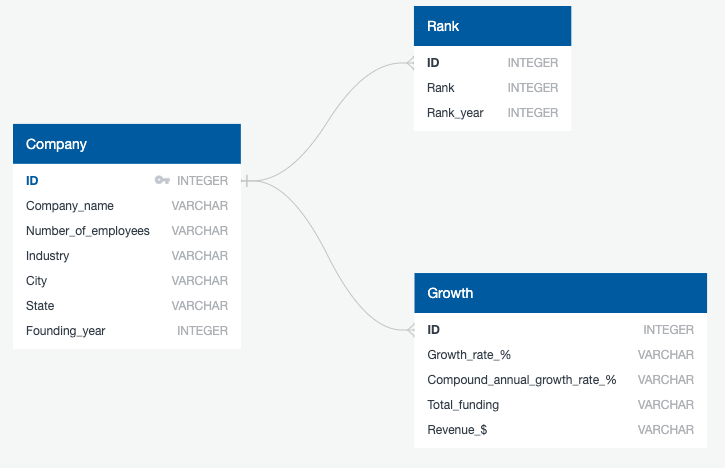
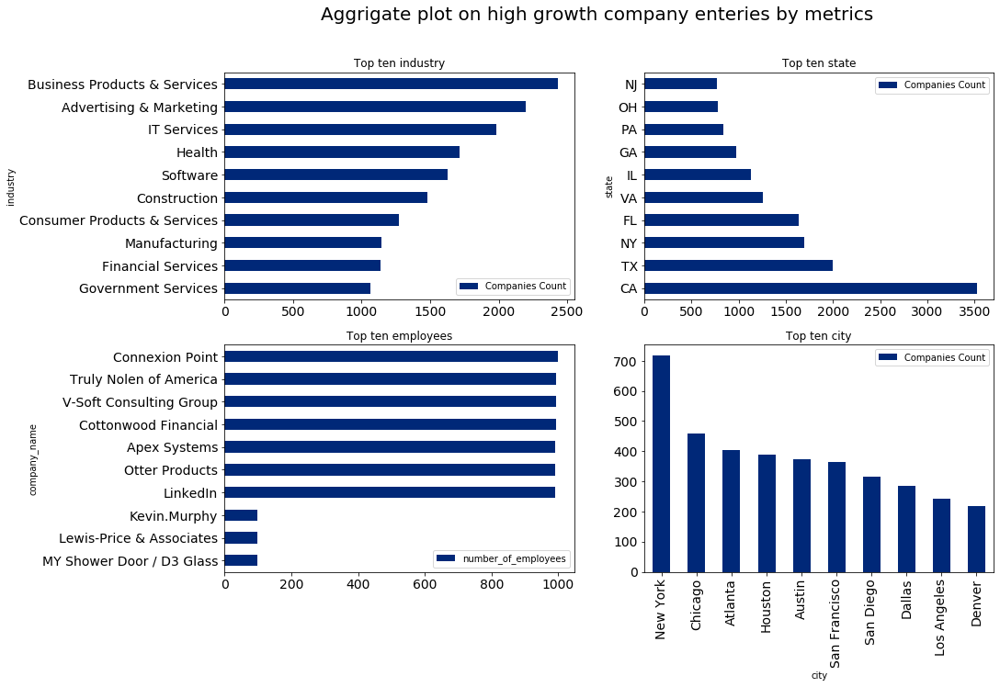
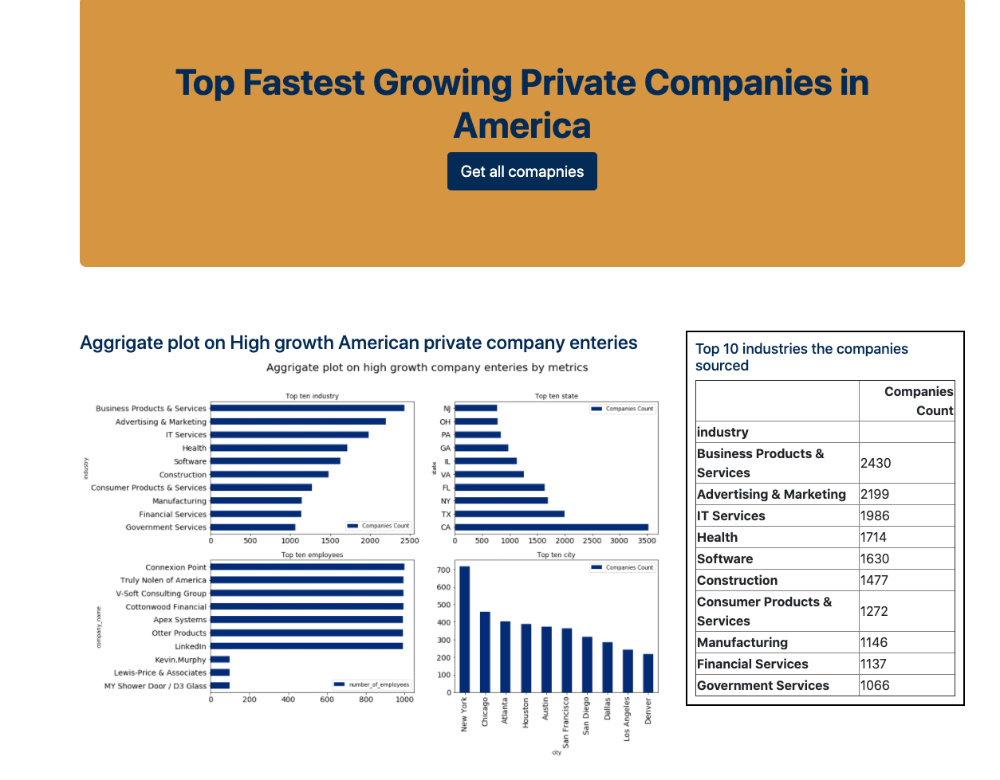

# ETL Project: America's Fastest-Growing Private Companies (2007–2020)


An **Extract-Transform-Load** pipeline that combines three sources (a CSV dataset, web scraping and a REST API) into a single PostgreSQL database of America's fastest-growing private companies over 13 years, and serves it through a Flask API.


## Pipeline

| Stage | What happens |
|---|---|
| **Extract** | **Inc. 5000** rankings 2007–2019 (CSV, ~60k rows) · **Financial Times** *Americas' Fastest-Growing Companies 2020* (web scraping) · **Growjo** company profiles (REST API, queried by domain) |
| **Transform** | Pandas: standardize column names, drop unused columns, remove duplicates, join sources on company, and aggregate totals |
| **Load** | Three normalized PostgreSQL tables: `Company`, `Ranks` and `Growth` |
| **Serve** | Flask app with a home page and a `/companies` JSON endpoint |

The final database holds **24,115 unique companies**.

### Sources

- **Inc. 5000** via data.world: [2019](https://data.world/aurielle/inc-5000-2019) · [2018](https://data.world/aurielle/inc-5000-2018) · [2007–2017](https://data.world/aurielle/inc-5000-10-years)
- **Financial Times**: [Americas' Fastest-Growing Companies 2020](https://www.ft.com/americas-fastest-growing-companies-2020)
- **Growjo**: [Company API](https://growjo.com/company_api). [`company_domain.py`](company_domain.py) lists the company domains that were queried.

## Data model



| Table | Key columns |
|---|---|
| `Company` | `id` (PK), `company_name`, `number_of_employees`, `industry`, `city`, `state`, `country`, `founding_year` |
| `Ranks` | `id` (FK → Company), `rank`, `rank_year` |
| `Growth` | `id` (FK → Company), `growth_rate`, `compound_annual_growth_rate`, `total_funding`, `revenue_$` |

Schema: [`schema.sql`](schema.sql) · Example queries (top industries, states and cities): [`query.sql`](query.sql)

## Results



## Flask app

| Route | Returns |
|---|---|
| `/` | Project home page |
| `/companies` | Every row of the `Company` table as JSON |



## Getting started

```bash
git clone https://github.com/ermiasgelaye/ETL-Project.git
cd ETL-Project
pip install -r requirements.txt

createdb top-companies_db
psql -d top-companies_db -f schema.sql

export DATABASE_URL="postgresql+psycopg2://postgres:<password>@localhost:5432/top-companies_db"
jupyter notebook ETL_data_project.ipynb   # runs extract, transform and load

cd flask_api_app && python app.py         # http://127.0.0.1:5000
```

Both the notebook and the app read the connection string from `DATABASE_URL`. If your password contains special characters such as `@`, URL-encode them (for example, `@` becomes `%40`).

## Project structure

```
ETL-Project/
├── ETL_data_project.ipynb   # full ETL pipeline
├── company_domain.py        # domains queried from the Growjo API
├── schema.sql · query.sql   # database schema and analysis queries
├── Resources/               # Inc. 5000 CSV files
├── flask_api_app/           # Flask app (app.py, templates/, static/)
├── requirements.txt
└── Image/                   # README images
```

## Team

Adedamola Atekoja ('Damola) · Amanda Qianyue Ma · Amos Johnson · Ermias Gaga · Maria Lorena
